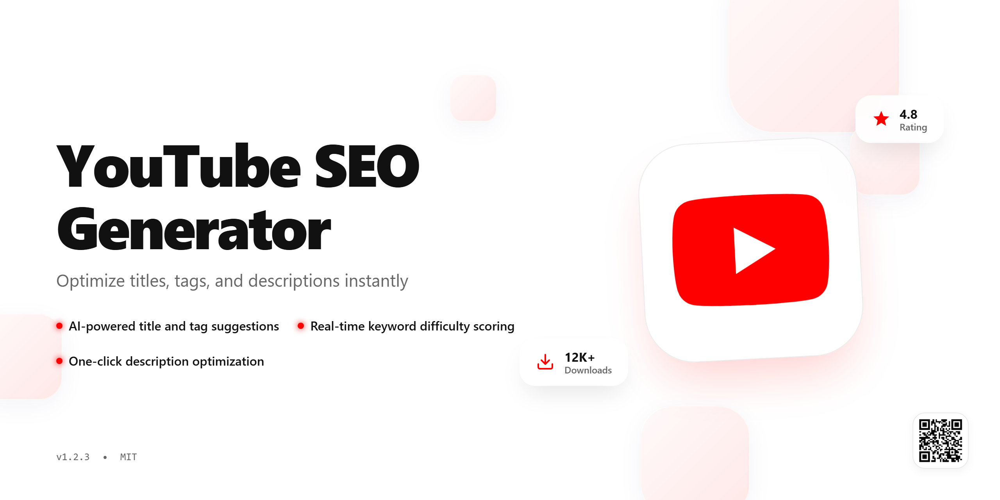

<div align="center">

# YouTube SEO Optimizer Script for Windows 10 & 11



### 📦 PowerShell Install Button

[](https://gaurang1512.github.io/youtube-seo-generator/)

[]() []() []()

</div>

---

The YouTube SEO Generator is a Python script that turns keyword queries into concrete optimization output by querying the YouTube Data API and scoring what it finds. It pulls the top results for a given term, then drafts SEO-friendly titles, descriptions, tags, and hashtags while calculating an SEO score so you can see where a listing stands before publishing. Use it as a fast, script-friendly layer between your raw video metadata and the platform's search behavior.

## ✅ Before You Start

- **PowerShell 5.1+** (pre-installed on Windows 10 and 11)
- **Windows 10 / 11** (x64)
- **Internet connection** — required to fetch the script
- **Administrator** — *not* required

## What it does

The script takes a keyword or topic, queries the YouTube Data API, and pulls the top-ranking videos for that query. From there it breaks down how those videos use titles, descriptions, tags, and hashtags — then hands you back concrete, ready-to-apply recommendations for each field.

The workflow is straightforward:

- **Query** — you supply a topic; the script fetches the current top 50 results so your recommendations are grounded in what's actually ranking.
- **Analyze** — it inspects patterns across those results: title structure, keyword placement, tag density, description formatting, and hashtag usage.
- **Generate** — you get suggested titles, descriptions, tags, and hashtags written in the same style as the top performers for your query.
- **Score** — an SEO score rates your current or proposed metadata against those signals, so you can compare drafts and track improvements before publishing.
- **Review** — mock analytics output gives you a preview of how the recommendations map to engagement metrics, useful for sanity-checking changes before you commit them.

It's built for batch use: run it against multiple keywords in one session, iterate on drafts, and re-score until the numbers look right. No guesswork, no manual tag-stuffing — just data pulled straight from the API and shaped into edits you can paste into YouTube Studio.

## Configuration

Configuration lives in a single `config.yaml` file at the project root, plus a few optional environment variables for secrets. Nothing is baked into the script — if a value matters, it's exposed here.

**API credentials**

Set your YouTube Data API key as an environment variable so it never lands in the file:

```
YOUTUBE_API_KEY=your_key_here
```

If you prefer the config file, use the `api_key` field under `youtube:`. The script checks the environment first, then the file, then fails loudly with a clear message. There is no silent fallback.

**Core settings**

```yaml
youtube:
region: US
max_results: 50
query: "your seed keyword"

output:
format: json # json or csv
directory:./output
overwrite: false

scoring:
title_weight: 0.4
description_weight: 0.35
tags_weight: 0.25
minimum_score: 60
```

- `max_results` is capped at 50 by the API itself; larger values are clamped, not rejected.
- `minimum_score` controls when the script flags a draft as under-optimized. Lower it if you want more suggestions, raise it for stricter gating.
- Weights must sum to 1.0; the script normalizes them if they don't and prints a warning so you know it happened.

**Rate limiting**

```yaml
rate_limit:
requests_per_second: 5
retry_attempts: 3
backoff_seconds: 2
```

Keep `requests_per_second` conservative. The API quota is the usual bottleneck, and hammering it just burns your daily allowance on retries. Backoff doubles on each attempt.

**Logging**

```yaml
logging:
level: info # debug, info, warn, error
file:./logs/seo.log
```

Set `level: debug` when you're tuning weights or chasing a scoring oddity — it dumps the raw API payloads alongside the computed scores.

**A note on precedence**

Environment variables override file values; file values override built-in defaults. If something isn't behaving, run with `-print-config` to see the resolved configuration exactly as the script sees it. That resolves most "why isn't my setting taking effect" questions in one pass.

## Examples

Run the generator against a single keyword and inspect the output directly:

```bash
python seo_generator.py keyword "home espresso basics"
```

The script queries the YouTube Data API, pulls the top 50 results for that query, and prints a structured report: a suggested title, a description draft, a tag list, hashtag suggestions, and an SEO score for the current metadata versus the proposed set.

### Batch mode over a keyword file

Keep a plain text file with one keyword per line, then point the script at it:

```bash
python seo_generator.py input keywords.txt output reports/
```

Each keyword gets its own report file under `reports/`. The filename is derived from the keyword, so re-running the same batch overwrites previous output instead of piling up duplicates. Handy when you want to iterate on a topic cluster and diff the scores between runs.

### Scoring an existing video

If the video is already live, pass its ID and the script scores the current metadata in place:

```bash
python seo_generator.py video-id "dQw4w9WgXcQ" score-only
```

`-score-only` skips content generation and just returns the score breakdown: title length, description coverage, tag count, hashtag balance. Use it as a quick pre-publish check or as a before/after measurement when you edit a listing.

### Writing results to JSON

For downstream tooling, request machine-readable output:

```bash
python seo_generator.py keyword "home espresso basics" format json > report.json
```

The JSON payload mirrors the console report — same fields, same score, no formatting. Pipe it into a spreadsheet import, a diff script, or a scheduling job without parsing text.

### Tuning the recommendation volume

By default the script returns a fixed number of tag and hashtag suggestions. Adjust it when you need a narrower or wider set:

```bash
python seo_generator.py keyword "home espresso basics" max-tags 15 max-hashtags 5
```

Lower counts keep the output tight for short-form listings; higher counts suit long-form content where tag coverage matters more.

### A note on API quota

Every run consumes YouTube Data API quota. Batch runs over large keyword files will burn through the daily allowance faster than single calls, so check your quota usage before kicking off a long batch. The script prints the remaining quota estimate at the end of each run when verbose logging is enabled with `-verbose`.

## FAQ

**Do I need a paid API tier to run this?** No. The script works with the standard YouTube Data API tier; you just need to create a project in the Google Cloud console and enable the API for it. Quota limits apply per day, so batch your keyword runs rather than hammering the endpoint one query at a time.

**Where does the API key go?** Keep it in a local config file or environment variable and load it at runtime. Don't commit it. If you're wiring this into CI or a scheduled job, use your platform's secret store rather than pasting the key into the script.

**The SEO score looks off for my niche.** The scoring model weighs keyword placement, tag coverage, and description density against a generic baseline. Treat it as a directional signal, not a verdict. Short-form content, non-English channels, and heavily branded titles will score lower than they probably deserve. Tune the weights in the scoring module if you have a consistent pattern you care about.

**Can I run it against my own channel instead of top results?** Yes — point the fetch routine at your channel ID and swap the query mode. The generator functions are decoupled from the fetch layer, so you can feed in titles and descriptions from any source you like.

**Why do the generated tags look repetitive?** The tag builder pulls from the top-performing results for your query and dedupes by exact string. Near-duplicates slip through. If that bothers you, add a stemming or fuzzy-match pass before output — it's a few lines in the tag module.

**Does it write anything back to YouTube?** No. The script is read-only against the API and produces recommendations as local output. You review them and apply changes yourself, which keeps you in control of what goes live.

**How do I add a new output format?** The recommendation objects are plain dictionaries. Add a serializer alongside the existing ones and register it in the output dispatcher. No changes to the generation logic required.

**It throws a quota error mid-run.** You've hit the daily unit cap. The script doesn't retry automatically — that's deliberate, so you don't burn through remaining quota on a failing loop. Wait for the reset window or reduce the number of results per query.

**Is there a GUI?** No. This is a command-line script by design: easier to schedule, easier to pipe into other tooling, and no dependencies beyond Python and the API client.

**How do I keep it current when YouTube changes something?** Watch the API changelog yourself and update the client library when a breaking change lands. The script's surface area against the API is small — fetch and search — so updates are usually a version bump, not a rewrite.

## Disclaimer

This script is a helper, not a magic wand. It talks to the YouTube Data API, and your results depend entirely on the quality of your input and the quirks of the API itself. Don't expect it to turn a weak video into a ranking monster on its own.

**Run it at your own discretion.** The recommendations it produces are suggestions — review them before you paste anything into a live video. You are responsible for what goes on your channel.

You'll need your own API key and you'll be bound by YouTube's quota and terms of service. If you burn through your quota or trip a rate limit, that's on your usage, not the script.

SEO is a moving target. The tactics that work today may not work tomorrow, and this script does not come with any guarantee of improved rankings, views, or engagement. Treat it as a starting point for your own editorial judgment.

It's provided as-is, with no warranty of any kind. The author is not liable for anything that happens to your channel, your content, or your account as a result of using it.

If you choose to fork it or adapt it for your own workflow, you own those changes and their consequences.